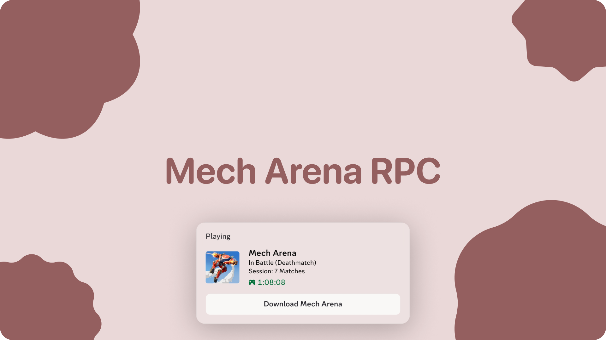

# Mech Arena Discord Rich Presence

<p align="center">
  
</p>

<p align="center">
  
  
  
</p>

A small Linux tray daemon that shows what you are doing in **Mech Arena** as **Discord Rich Presence**. It detects the game running under Wine/Proton, watches whether you are in the hangar or in a match, and can read the in-match HUD to tell **Deathmatch**, **Control Point Clash**, and **Free-For-All** apart.

> Unofficial fan project. Not affiliated with Plarium or Discord. Use at your own risk.

---

## Features

- **Automatic presence** — "In Hangar", "In Battle", "Viewing Results", with elapsed timers.
- **Game mode detection** — optional HUD screenshot analysis for Deathmatch, CPC, and FFA.
- **Post-match screen** — holds "Viewing Results" for 10 seconds after a battle ends.
- **System tray UI** — live status, log viewer, quit, and "Dispatch" to detach from the terminal.
- **Detached background mode** — survives the terminal being closed (`SIGHUP` ignored, new kernel session).
- **Low overhead** — polls every 2 seconds; no memory reading or packet capture at runtime.
- **Logging** — timestamped log at `~/.cache/mech_arena_rpc.log`.
- **Minimal standalone script** — `MechArena.py` for a no-tray, console-only setup.

---

## How it works

```
┌──────────────────────┐
│ MechArena.exe (Wine) │
└──────────┬───────────┘
           │ psutil: process name + open UDP sockets
           ▼
   ┌───────────────────┐        CLOSED / MENU / BATTLE
   │ get_mech_state()  │──────────────────────────────┐
   └───────────────────┘                              │
                                                      ▼
                                        ┌──────────────────────────┐
                                        │ rpc_worker() state machine│
                                        └────────────┬─────────────┘
                                                     │
              in battle, after 15 s                  │ presence updates
                     ┌───────────────────────────────┤
                     ▼                               ▼
        ┌────────────────────────┐        ┌─────────────────────┐
        │ ImageMagick HUD capture│        │ Discord IPC socket  │
        │ 440x45 at (740,50)     │        │ via pypresence      │
        │ brightness heuristics  │        │ (Rich Presence)     │
        └────────────────────────┘        └─────────────────────┘
```

1. `psutil` finds a process whose name contains `mecharena.exe`.
2. If the process has any open UDP socket it is treated as **in battle**, otherwise **in menu**. No process means **closed**.
3. `xwininfo` resolves the XWayland window ID, and ImageMagick's `import` grabs the top-centre HUD strip.
4. The strip is converted to grayscale and split into centre/edge regions. The brightness ratio determines the mode.
5. `pypresence` pushes the resulting presence to Discord over the local IPC socket.

A full explanation lives in the [wiki](wiki/Home.md).

---

## Requirements

| Requirement | Notes |
| --- | --- |
| Linux + X11 or Wayland with XWayland | The game window must be visible to X11 tools (`xwininfo`, `import`). |
| Discord desktop client | Must be running. Sandboxed Flatpak/Snap installs may block the IPC socket. |
| Mech Arena via Wine/Proton | Windowed or borderless; ideally **1920×1080** with 100% UI scale for HUD mode detection. |
| Python 3.9+ | A local virtualenv is recommended. |
| ImageMagick | Provides the `import` screenshot tool. |
| `x11-utils` | Provides `xwininfo`. |
| Python packages | `pypresence`, `psutil`, `Pillow`, `pystray`. |
| PyGObject + AppIndicator | Needed by the tray backend on Wayland/KDE. Install from distro packages. |

### Optional tools for `TestingTools/`

`pytesseract` + `tesseract-ocr`, `UnityPy`, `mss`, `numpy`, `opencv-python-headless`. These are research probes and are **not** used by the production daemon.

### Install

```bash
cd DiscordRPC

python3 -m venv --system-site-packages .venv
source .venv/bin/activate

pip install pypresence psutil pillow pystray
```

The `--system-site-packages` flag lets the virtualenv see the distro's PyGObject (`gi`) and AppIndicator bindings. Without it, `RPCA.py` may fail to create the tray icon even though the system packages are installed.

System packages (names vary by distro):

```bash
# Arch
sudo pacman -S imagemagick xorg-xwininfo libayatana-appindicator python-gobject

# Debian / Ubuntu
sudo apt install imagemagick x11-utils gir1.2-ayatanaappindicator3-0.1 python3-gi
```

> `PyGObject` is usually best installed from the distro package manager; `pip install PyGObject` often fails without build dependencies. `RPCA.py` forces `PYSTRAY_BACKEND=appindicator`, so the Ayatana/AppIndicator typelib must be available.

---

## Usage

### Full tray daemon (recommended)

```bash
source .venv/bin/activate
python RPCA.py
```

A tray icon appears. The daemon logs to the terminal **and** to `~/.cache/mech_arena_rpc.log`.

### Detach from the terminal

Right-click the tray icon → **Dispatch (Detach Terminal)**.

The daemon relaunches itself with `--detached` in a new kernel session, redirects stdio to `/dev/null`, and the original process exits. The new instance keeps running after the terminal closes and writes to the log file only.

### Minimal console daemon

```bash
python MechArena.py
```

This variant has no tray, no HUD mode detection, and no results screen. It prints state changes and stops with `Ctrl+C`. Because it never reads the screen, the HUD crop and UI scale do not matter.

### Autostart (optional)

Create `~/.config/autostart/mech-arena-rpc.desktop`:

```ini
[Desktop Entry]
Type=Application
Name=Mech Arena RPC
Exec=/home/YOUR_USER/DiscordRPC/.venv/bin/python /home/YOUR_USER/DiscordRPC/RPCA.py --detached
X-GNOME-Autostart-enabled=true
```

Adjust the paths and your username.

---

## Presence states

| Situation | Details | State | Timer |
| --- | --- | --- | --- |
| Game running, menu/hangar | `In Hangar` | `Main Menu` | Session elapsed |
| Battle just started | `In Battle` | `Combat Session` | Match elapsed |
| Mode detected after 15 s | `In Battle (Deathmatch)` etc. | `Combat Session` | Match elapsed |
| Battle ended, first 10 s | `Viewing Results` | `Post-Match (Deathmatch)` etc. | Session elapsed |
| After results | `In Hangar` | `Main Menu` | Session elapsed |
| Game closed | Presence cleared | — | — |

All states use the `mech_arena_logo` asset (large image), the text `Mech Arena`, and a **Download Mech Arena** button.

---

## Game mode detection at a glance

The production detector crops a `440x45` region at `+740+50` (top-centre HUD, 1920×1080), converts it to grayscale, and compares the average brightness of the centre 30% against the outer 15% edges:

| Mode | Heuristic |
| --- | --- |
| **Deathmatch** | `center/edge <= 0.88` **or** `edge >= 150` — bright score wings on both sides. |
| **Control Point Clash** | `center >= 95` **and** `center/edge >= 1.20` — bright central beacon cluster. |
| **Free-For-All** | `center < 95` — dim overall profile. |
| **Unknown** | Falls back to `In Battle`. |

Detection is attempted 15 seconds after the battle starts; the first successful read is locked for the rest of the match to avoid flickering. If the lookup/capture fails, the daemon retries up to **3 times with a 2-second delay** before falling back to the normal 2-second poll. The log prints the raw values (`HUD Analysis: Center=..., Edge=..., Ratio=...`) so you can tune the thresholds.

The crop is resolution- and UI-scale-dependent. See [Mode Detection](wiki/Mode-Detection.md) and [Configuration](wiki/Configuration.md) for calibration.

---

## Project structure

```
DiscordRPC/
├── RPCA.py                 # Full daemon: tray, logging, HUD mode detection, detach
├── MechArena.py            # Minimal console-only RPC daemon
├── README.md
├── wiki/                   # Detailed documentation
│   ├── Home.md
│   ├── Architecture.md
│   ├── Game-State-Detection.md
│   ├── Mode-Detection.md
│   ├── Discord-Presence.md
│   ├── Tray-and-Daemon.md
│   ├── Configuration.md
│   ├── Testing-Tools.md
│   ├── Troubleshooting.md
│   ├── Glossary.md
│   └── _Sidebar.md
└── TestingTools/           # Research probes, not used at runtime
    ├── RPCdaemon.py        # Tray-less prototype of the detection loop
    ├── DetectMode.py       # OCR experiment
    ├── CountBeacons.py     # Column-brightness beacon counter
    ├── DumpStrip.py        # ASCII brightness profile / calibration
    ├── InspectUHD.py       # RGB colour counting
    ├── LiveStats.py        # Dumps CPC score crops
    ├── FindScene.py        # Memory string scanner
    ├── TestMode.py         # Memory-based mode classifier
    ├── TestSceneQuick.py   # Fast scene-tag scanner
    ├── TestBeaconObject.py # Unity beacon class scanner
    ├── CompareModes.py     # Mode signature frequency comparison
    ├── AnalyzeGame.py      # General memory string search
    ├── StripAssets.py      # Unity asset/icon extractor
    ├── SniffHandshake.py   # Raw UDP capture (port 7015)
    ├── SniffLoopback.py    # Loopback TCP capture (5200/50306)
    ├── TestNet.py          # Earlier loopback capture variant
    └── TestCrop.py         # mss full-screen capture
```

---

## `RPCA.py` vs `MechArena.py`

| | `RPCA.py` | `MechArena.py` |
| --- | --- | --- |
| Tray icon / menu | ✅ | ❌ |
| HUD mode detection | ✅ | ❌ |
| "Viewing Results" state | ✅ | ❌ |
| Detached background mode | ✅ | ❌ |
| Log file | ✅ | ❌ (console only) |
| Poll interval | 2 s | 3 s |
| Dependencies | `pypresence`, `psutil`, `Pillow`, `pystray` | `pypresence`, `psutil` |
| Best for | Normal use | Minimal setups / debugging |

Both scripts share the same process/UDP state detection. For a quick test of Discord connectivity, `MechArena.py` is the smallest possible starting point.

---

## Configuration

The important values live at the top of `RPCA.py`:

```python
CLIENT_ID = "1565766221813776505"
HUD_CROP_GEOM = "440x45+740+50"   # WxH+X+Y
MODE_LOCK_DELAY = 15              # seconds after battle start
HUD_LOOKUP_RETRIES = 3            # retries after the first failed lookup
HUD_LOOKUP_RETRY_DELAY = 2        # seconds between attempts
RESULTS_DISPLAY_DURATION = 10     # seconds
LOG_FILE = Path.home() / ".cache/mech_arena_rpc.log"
```

To use your own Discord application, replace `CLIENT_ID`. If you want the large image, upload an asset named `mech_arena_logo` in the Discord Developer Portal, or change `large_image` in the `rpc.update(...)` calls. Full details: [Configuration](wiki/Configuration.md).

---

## Testing tools

`TestingTools/` contains the investigation scripts used to figure out how to detect the game state and mode. They explore four approaches:

- **Process/network** — UDP socket presence and raw packet capture.
- **Memory** — search `/proc/<pid>/mem` for Unity scene, beacon, and mode strings.
- **Screen** — crop the HUD, measure brightness peaks, count coloured pixels, and try OCR.
- **Assets** — unpack Unity cache bundles for mode icons.

The production daemon deliberately uses only **process + UDP + one HUD screenshot** per match. The rest are documented experiments. See [Testing Tools](wiki/Testing-Tools.md) for every script, how to run it, and what it showed.

> Some tools read process memory or open raw sockets. They may require root or relaxed `ptrace` permissions and may conflict with the game's terms of service or anti-cheat. Treat them as local research only.

---

## Troubleshooting

| Symptom | Likely cause | Fix |
| --- | --- | --- |
| No tray icon | AppIndicator/PyGObject missing | Install `libayatana-appindicator` + `python-gobject`; log in again. |
| "Waiting for Mech Arena..." forever | Process name mismatch | Check `pgrep -af mecharena`; compare with `"mecharena.exe"` in `get_mech_state()`. |
| Presence never appears | Discord not running / IPC blocked | Start Discord; check `$XDG_RUNTIME_DIR/discord-ipc-*`. |
| Presence freezes after Discord restarts | Stale IPC connection; updates are not wrapped | Restart the daemon. |
| Large image missing | Asset key not uploaded | Upload `mech_arena_logo` or change the key. |
| Mode always "In Battle" | HUD crop wrong for your resolution/UI scale | Recalibrate `HUD_CROP_GEOM`. |
| Mode shows "In Battle (In Battle)" | Heuristics were inconclusive | Cosmetic; tune thresholds. See wiki. |
| Game is in battle but shows hangar | The UDP heuristic missed the socket | Check `ss -u -p`; if no UDP socket is open, the heuristic cannot see the battle. |
| Shows battle while in the hangar | A non-match UDP socket is open | Try the prototype's remote-address check. |
| Screen capture is black | Window minimised / capture denied | Keep the game visible on the XWayland display. |
| Log viewer does nothing | No supported terminal/editor found | Install one of `ghostty`, `kitty`, `alacritty`, `konsole`, `kate`, `gedit`, or `xdg-open`. |

More: [Troubleshooting](wiki/Troubleshooting.md).

---

## Documentation

Start at the [wiki home](wiki/Home.md).

- [Architecture](wiki/Architecture.md) — components, threads, data flow, design choices.
- [Game State Detection](wiki/Game-State-Detection.md) — how process and UDP checks work.
- [Mode Detection](wiki/Mode-Detection.md) — the HUD brightness algorithm in detail.
- [Discord Presence](wiki/Discord-Presence.md) — presence lifecycle, timers, reconnects.
- [Tray and Daemon](wiki/Tray-and-Daemon.md) — tray UI, logging, detach/dispatch.
- [Configuration](wiki/Configuration.md) — every constant and how to change it.
- [Testing Tools](wiki/Testing-Tools.md) — the research scripts and their findings.
- [Troubleshooting](wiki/Troubleshooting.md) — diagnostics and common fixes.
- [Glossary](wiki/Glossary.md) — terms used throughout the docs.

---

## Known limitations

- Linux-only: relies on `xwininfo`, ImageMagick `import`, and Wine process names.
- HUD mode detection assumes a **1920×1080** game window with the default UI layout.
- Mode detection is a one-shot heuristic 15 seconds into a match; a misread persists until the next match.
- The UDP socket heuristic is intentionally simple. Any UDP socket counts as "in battle" in the production scripts.
- Memory-scanning and packet-capture tools are exploratory and may break with game updates.
- Discord Rich Presence is not a supported game API; UI or platform changes can break it.
- A Discord restart mid-session can leave a stale IPC connection; presence updates may stop until the daemon is restarted.

## Disclaimer

This is an unofficial community project, provided as-is with no warranty. It does not modify the game, inject code, or automate gameplay. Reading process memory or capturing network traffic may violate the game's terms of service in your jurisdiction; use those research tools responsibly and only on your own machine.
