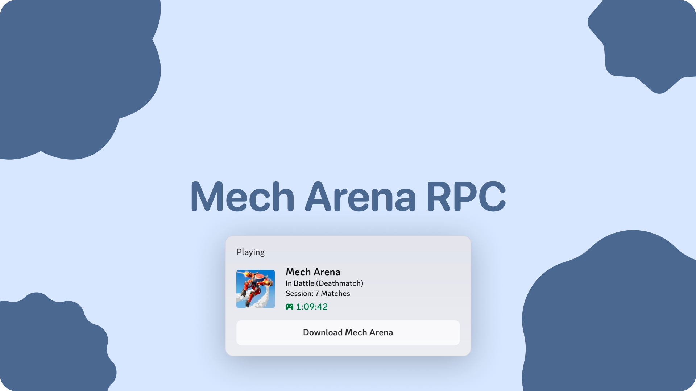

# Mech Arena Discord Rich Presence

<p align="center">
  
</p>

<p align="center">
  
  
  
</p>

A lightweight Linux tray daemon that displays your live **Mech Arena** status as **Discord Rich Presence**. It automatically detects the game running under Wine/Proton, differentiates whether you are in the hangar or in combat, reads the HUD to detect the game mode (**Deathmatch**, **Control Point Clash**, or **Free-For-All**), and tracks matches played throughout your session.

> Unofficial fan project. Not affiliated with Plarium or Discord. Use at your own risk.

---

## Features

- **Automated Presence** — Displays "In Hangar", "In Battle", and "Viewing Results" with live elapsed session/match timers.
- **HUD Mode Detection** — Analyzes top-center HUD brightness to identify Deathmatch, CPC, and FFA without memory reading or OCR latency.
- **Session Match Counter** — Live counter tracking total matches played across your gaming session.
- **System Tray UI** — Quick status monitor, match counter reset, live log viewer, and seamless restart controls.
- **Detached Background Mode** — "Dispatch" frees the controlling terminal immediately into an independent background process (`SIGHUP` ignored).
- **Seamless In-Tray Updates** — "Restart / Apply Update" reloads modified local code on disk while seamlessly preserving active session timers and match counts.
- **Low Overhead** — Polls system state every 2 seconds; zero code injection, memory patching, or network packet sniffing at runtime.

---

## Quick Start (Automated Setup)

The included `setup.sh` script automatically detects your distribution (Arch, Fedora, Ubuntu/Debian, openSUSE), installs required system packages (`imagemagick`, `xwininfo`, `libappindicator`), and prepares a pre-configured Python virtual environment:

```bash
git clone [https://github.com/wollydev24/DiscordRPC.git](https://github.com/wollydev24/DiscordRPC.git)
cd DiscordRPC

chmod +x setup.sh
./setup.sh

```

Once complete, launch the daemon:

```bash
.venv/bin/python RPCA.py

```

---

## Usage

### 1. Running the Daemon

```bash
.venv/bin/python RPCA.py

```

A visor tray icon appears in your desktop panel. The daemon streams status events to both the terminal and `~/.cache/mech_arena_rpc.log`.

### 2. Detach from Terminal

Right-click the tray icon and select **Dispatch (Detach Terminal)**.

The process immediately creates an orphaned kernel session (`setsid`), closes all terminal file descriptors, and cleanly exits the foreground shell. You can safely close your terminal window without interrupting the presence daemon.

### 3. Hot-Reloading Updates

Right-click the tray icon and select **Restart / Apply Update**.

This re-executes the script from disk to instantly apply any recent git pulls or configuration tweaks while preserving your active session duration and match tally via CLI persistence flags (`--session-start`, `--matches`).

### 4. Viewing Logs

Right-click the tray icon and select **Show Log**.

This automatically detects and spawns your installed terminal (`ghostty`, `kitty`, `alacritty`, `konsole`) with a live `tail -f` stream, or opens the file in your default GUI text editor (`kate`, `gedit`, `xdg-open`).

### 5. Minimal Console Daemon (Alternative)

```bash
.venv/bin/python MechArena.py

```

This variant has no tray, no HUD mode detection, and no results screen. It prints state changes and stops with `Ctrl+C`. Because it never reads the screen, HUD crops and UI scaling do not matter.

---

## Autostart (Desktop Launcher)

To run the daemon silently in the background whenever you log into your desktop:

Create `~/.config/autostart/mech-arena-rpc.desktop`:

```ini
[Desktop Entry]
Type=Application
Name=Mech Arena Discord RPC
Exec=/home/YOUR_USER/DiscordRPC/.venv/bin/python /home/YOUR_USER/DiscordRPC/RPCA.py --detached
Hidden=false
NoDisplay=false
X-GNOME-Autostart-enabled=true

```

*(Remember to replace `YOUR_USER` with your actual Linux username.)*

---

## How It Works

1. **State Polling:** `psutil` monitors for `mecharena.exe`. If the process has an active UDP network socket open, it flags the state as `IN_BATTLE`; otherwise, it assumes `IN_HANGAR`.
2. **Mode Recognition:** 15 seconds after a battle starts, `xwininfo` grabs the XWayland window ID and ImageMagick's `import` extracts the top-center HUD strip (`440x45+740+50`). The daemon calculates the ratio between the center cluster and edge wings to mostly reliably identify **Deathmatch**, **Control Point Clash**, or **Free-For-All**.
3. **Presence Updates:** `pypresence` transmits the payload over Discord's local IPC pipe socket.

---

## Game Mode Detection at a Glance

The production detector crops a `440x45` region at `+740+50` (top-center HUD, 1920×1080), converts it to grayscale, and compares the average brightness of the center 30% against the outer 15% edges:

| Mode | Heuristic |
| --- | --- |
| **Deathmatch** | `center/edge <= 0.88` **or** `edge >= 150` — bright score wings on both sides. |
| **Control Point Clash** | `center >= 95` **and** `center/edge >= 1.20` — bright central beacon cluster. |
| **Free-For-All** | `center < 95` — dim overall profile. |
| **Unknown** | Falls back to `In Battle`. |

Detection is attempted 15 seconds after the battle starts; the first successful read is locked for the rest of the match to avoid flickering. If the lookup/capture fails, the daemon retries up to **3 times with a 2-second delay** before falling back to the normal 2-second poll. The log prints raw values (`HUD Analysis: Center=..., Edge=..., Ratio=...`) for quick threshold tuning.

---

## Configuration

The primary configuration constants live near the top of `RPCA.py`:

```python
CLIENT_ID = "1565766221813776505"
HUD_CROP_GEOM = "440x45+740+50"   # WxH+X+Y
MODE_LOCK_DELAY = 15              # seconds after battle start
HUD_LOOKUP_RETRIES = 3            # retries after first failed lookup
HUD_LOOKUP_RETRY_DELAY = 2        # seconds between attempts
RESULTS_DISPLAY_DURATION = 10     # seconds
LOG_FILE = Path.home() / ".cache/mech_arena_rpc.log"

```

To use your own Discord application, replace `CLIENT_ID`. If you want the large image, upload an asset named `mech_arena_logo` in the Discord Developer Portal, or change `large_image` in the `rpc.update(...)` calls.

---

## Troubleshooting

| Symptom | Likely Cause | Fix |
| --- | --- | --- |
| No tray icon | AppIndicator/PyGObject missing | Install `libayatana-appindicator` + `python-gobject`; re-run `setup.sh`. |
| "Waiting for Mech Arena..." forever | Process name mismatch | Check `pgrep -af mecharena`; compare with `"mecharena.exe"` in `get_mech_state()`. |
| Presence never appears | Discord not running / IPC blocked | Start Discord; check `$XDG_RUNTIME_DIR/discord-ipc-*`. |
| Presence freezes after Discord restarts | Stale IPC connection | Right-click tray → **Restart / Apply Update**. |
| Mode always "In Battle" | HUD crop wrong for resolution/UI scale | Recalibrate `HUD_CROP_GEOM`. |
| Game is in battle but shows hangar | UDP socket missed | Verify game network activity using `ss -u -p`. |
| Screen capture is black | Window minimized / capture denied | Keep the game visible on the XWayland display. |
| Log viewer does nothing | No supported terminal/editor found | Install one of `ghostty`, `kitty`, `alacritty`, `konsole`, `kate`, `gedit`, or `xdg-open`. |

---

## Project Structure

```
DiscordRPC/
├── RPCA.py                 # Full daemon: tray, logging, HUD mode detection, detach
├── MechArena.py            # Minimal console-only RPC daemon
├── setup.sh                # Multi-distro automatic dependency installer
├── README.md
├── wiki/                   # In-depth architectural & reverse-engineering docs
└── TestingTools/           # Research probes (OCR, memory scans, network capture)

```

---

## Disclaimer

This is an unofficial community project, provided as-is with no warranty. It does not modify the game, inject code, or automate gameplay. Reading process memory or capturing network traffic may violate the game's terms of service in your jurisdiction; use those research tools responsibly and only on your own machine.

```

```